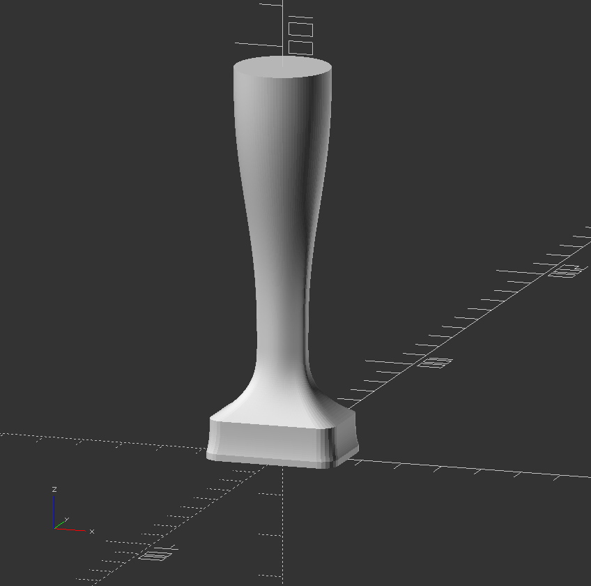

# BOSL2 Smooth Slicer (Advanced Lofting with Easing)

This is a utility script for OpenSCAD designed to extend the geometric capabilities of the BOSL2 library.

BOSL2 saved me months of work, and I wanted to give back to the community by sharing this tool. It is free to use, modify, and integrate into your own workflows or into BOSL2 itself.

## Preview



## What it does

* **Eased Skinning / Lofting:** Generates smooth, organic transitions between 2D shapes using parametric steps and easing functions (instead of standard linear transitions).
* **Automatic Resampling & Alignment:** Automatically resamples input shapes and aligns their zero-points, ensuring a perfectly clean 3D mesh free of vertex twists or rendering artifacts.
* **Fast Section Projections:** Extracts 2D section profiles mathematically from vector data, allowing you to instantly calculate the real-time width and height (bounding box) of the slice at any given Z-height without triggering slow CGAL 3D projections.

## How to Use

Simply include this utility alongside your BOSL2 library.

```openscad
include <BOSL2/std.scad>
include <smoothSlicer.scad>

$fn = 40;
$fa = 2;
radius_definition = 40;
sstep = 1;
slice_height = 0.5;
N = 72;

profile1 = rect([20, 15], rounding = 5, $fa = sstep, $fn = radius_definition);
profile2 = rect([18, 14], rounding = 4, $fa = sstep, $fn = radius_definition);
profile3 = supershape(step = sstep, m1=4, n1=12, n2=9, n3=5.5, a=8, b=9.7, d=12);
profile4 = circle(d=22, $fa = sstep, $fn = radius_definition);

profiles = [profile1, profile1, profile2, profile3, profile4];

heights = [ 0, 1.5, 6, 10, 80];

easings = ["linear", "out", "out", "quint"];

smoothSkin(profiles, heights, easings, slice_height);
```

## Credits & License

* **Author:** DamphirInTheNight
* **Dependencies:** Built on top of the incredible BOSL2 Library by RevarBat and contributors.
* **License:** Released under the MIT License.
